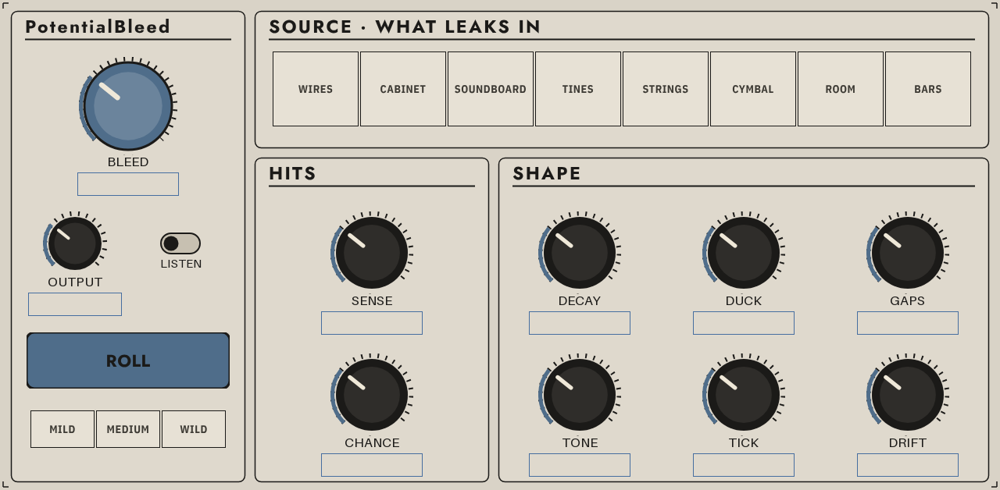
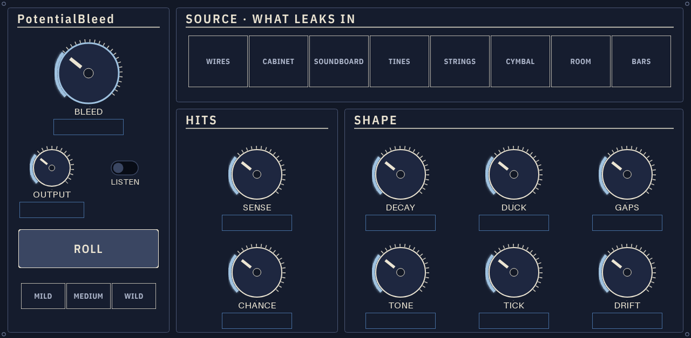

# PotentialBleed

**The sounds between the chops.** PotentialBleed listens for each hit and adds quiet, synthetic residue behind it: snare wires buzzing, a cabinet booming, a piano board ringing. Your chops sound like they came off a real recording, with other instruments leaking in.

*Insert effect · MPC OS 3.x · Gen1 and Gen2 · v1.2.0*

Free and open source (MIT), made by **PotentialBreaks**, part of the **PotentialSuite**, with the same four looks and LOOK switch as the rest of the suite. It runs inside the MPC as an insert effect, with its own touchscreen page, Q-Link control and project recall.

**[Download the latest release](../../releases/latest)** · [Ideas and bugs](../../issues/new/choose)

## What it does

- **SOURCE:** what leaks in. All eight are generated here (tuned resonances plus filtered noise), not recordings:

  | Source | Sounds like |
  |---|---|
  | **WIRES** | snare wires rattling behind the kick |
  | **CABINET** | a bass cabinet's low thump and boom |
  | **SOUNDBOARD** | a piano's wooden board ringing |
  | **TINES** | bright struck tines, electric-piano style |
  | **STRINGS** | string scrape and ring |
  | **CYMBAL** | a soft metallic wash |
  | **ROOM** | a small room's low ring and air |
  | **BARS** | vibraphone-like bars |

- **BLEED:** how much leaks in. Small amounts usually sound most real.
- **HITS:**
  - **SENSE** sets how hard a hit has to be (-60 to -6 dB).
  - **CHANCE** sets how often a hit leaks: 100% is every hit, lower values give the odd ghost.
- **SHAPE:**
  - **DECAY** sets how long the residue rings (30 ms to 1.5 s).
  - **DUCK** keeps it down under loud audio, and **GAPS** brings it up in the quiet spaces.
  - **TONE** goes from dark to bright.
  - **TICK** adds a needle tick on each hit.
  - **DRIFT** adds a slow, slightly different wobble left and right, to the whole sound.
- **LISTEN:** hear just the residue, to set it up. Turn it off again for the mix.
- **ROLL** picks a new source and shape. **MILD**, **MEDIUM** or **WILD** next to it sets how far it goes.
- **Presets** in the MPC's PRESET menu: Wires behind the kit, Bass in the room, Piano lid open, Rhodes shimmer, Guitar scrape, Cymbal wash, Small room, Vibes and Old record.
- **FX chains:** Dusty Loop, 90s Stab, Break Bus and Dub Drums. Pick the same name in PotentialPatina, PotentialPunch and PotentialGrit. See the [chains on the PotentialSuite page](https://github.com/PotentialBreakfast/potential-plugins#fx-chains).

Nothing is delayed. There's no lookahead, so your MPC's timing stays exactly where it was.

**Quick start:** put it on a chopped loop or a drum bus and turn **LISTEN** on. Lower **SENSE** until the important hits ring, then raise **BLEED** until you hear it clearly. Turn LISTEN off and bring BLEED back down until the residue sits behind the track.

**USER presets** (USER page): 8 slots of your own. Tap **SAVE**, then a slot, to keep the sound; tap a slot to bring it back. They're kept in `PotentialSuite Presets/PotentialBleed.txt` beside your VST2 Plugins folder, so every project sees them and updates keep them. The same slot number in each PotentialSuite effect makes a chain of your own.

**MANUAL page:** the manual is on the MPC's screen too. Tap **MANUAL**, then the page buttons along the top. The full [PotentialSuite manual](https://github.com/PotentialBreakfast/potential-plugins/blob/main/MANUAL.md) covers every plugin, the FX chains and a developer reference.

## Install

- **With MPC TOOLS:** in the Plugins tab, tap **UPDATE** on PotentialBleed.
- **With the Open MPC installer or Plugin Manager:** use `-mpc-armv7.zip` for a Gen1 (MPC One, Live, Live II, X, Key, Force) or `-mpc-aarch64.zip` for a Gen2.
- **By hand (MPC OS 3.10.1+):** unzip `-mpc-sdk.zip` and copy the folder `PotentialBreaks - VST - PotentialBleed` into `VST2 Plugins` at the top of a drive the MPC can see.

Then turn on **Preferences > Enhancements > VST2 Support**, restart the MPC, and add **PotentialBleed** as an insert effect.

## Credits and licence

MIT, see `LICENSE`. Inspired by Ghost Sample from 16 Levels. This is an independent design with its own code and its own sources. Built with the [Open MPC kit](https://github.com/open-mpc/mpc-vst-plugins) (MIT). Not affiliated with or endorsed by Akai Professional or inMusic.

---

## Tested on

MPC One (Gen1) on standard Akai firmware 3.10.1 and on the latest HAKAI firmware (USB-boot method). Gen2 64-bit builds pass Akai's checks but have had limited real-device testing so far.

